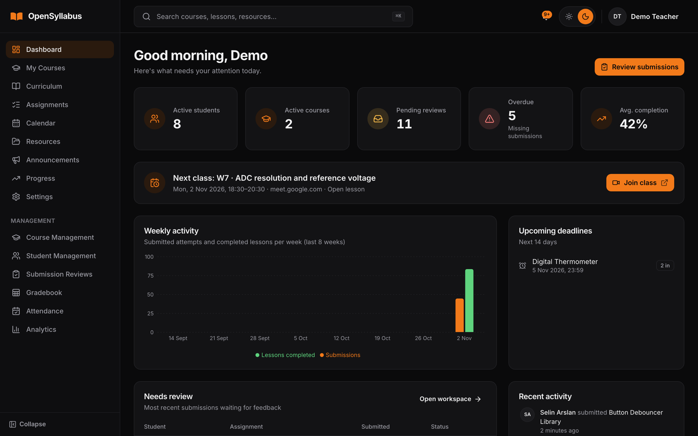
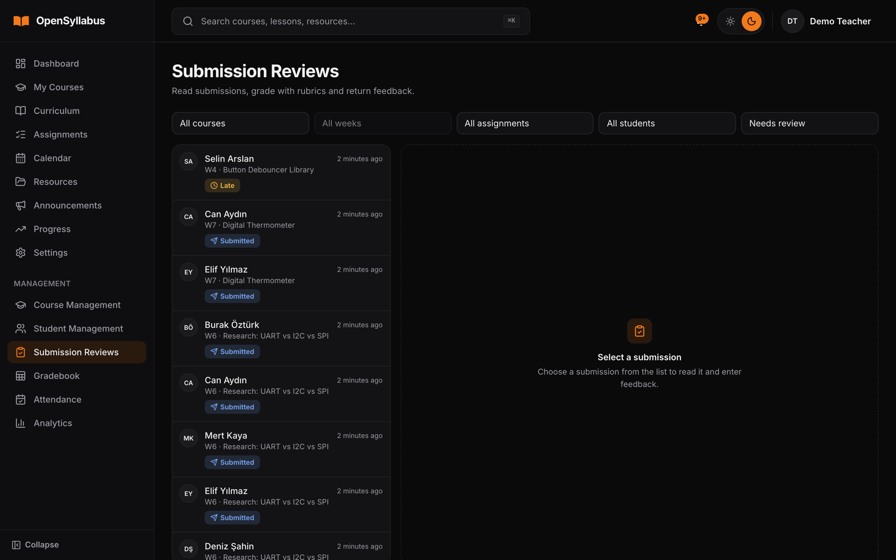
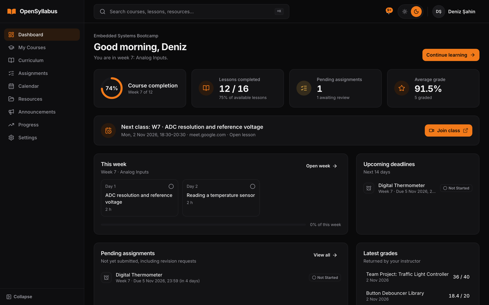
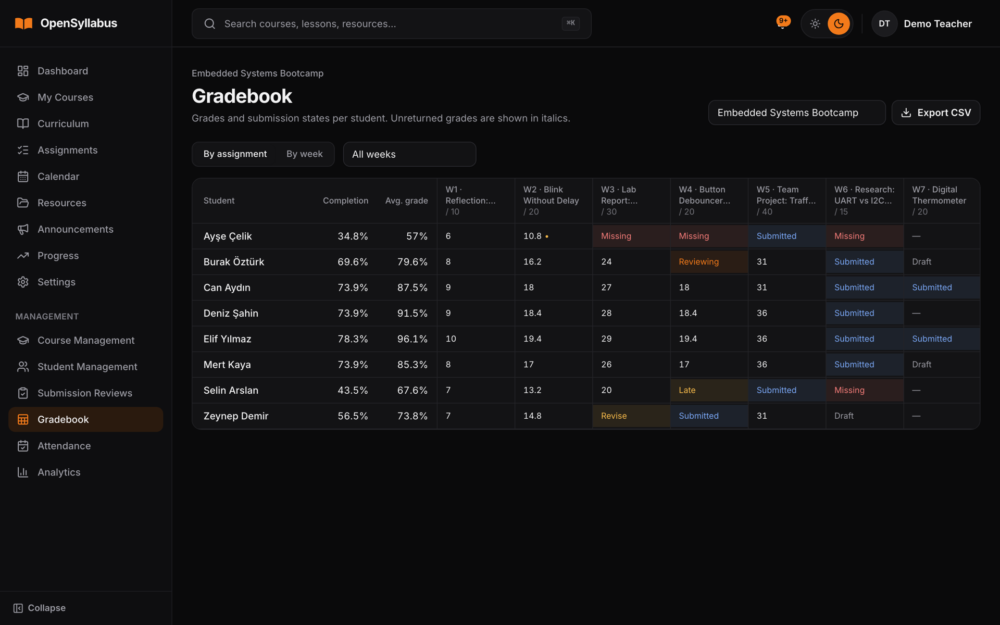
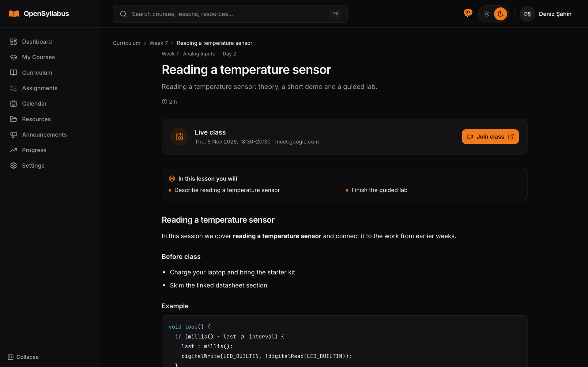
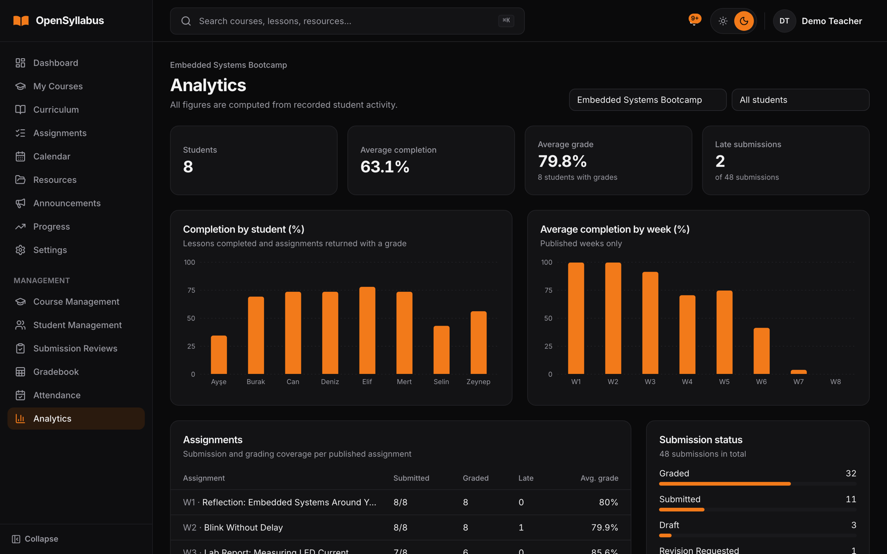
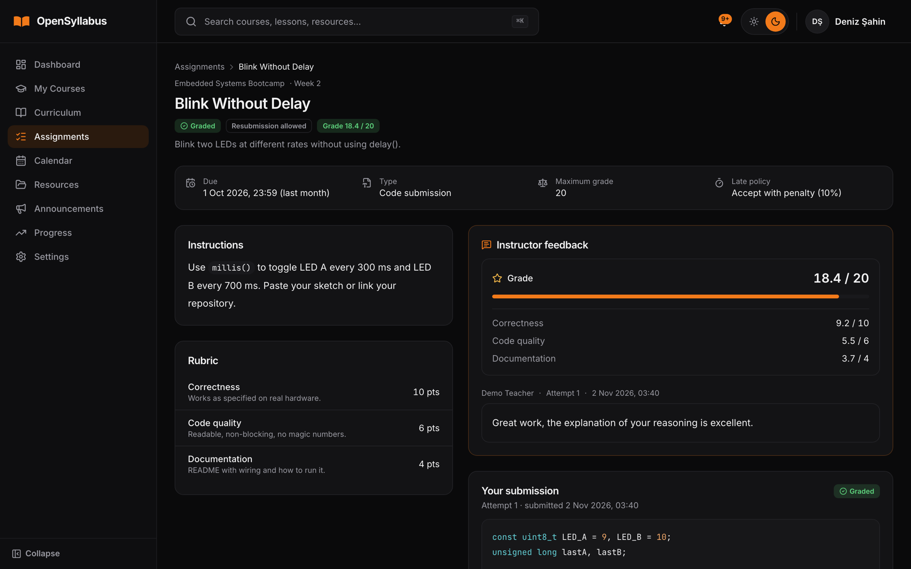
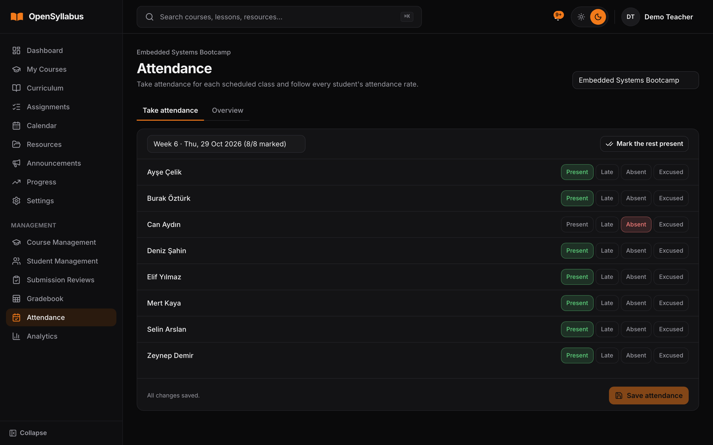

# OpenSyllabus

**A self-hosted, open-source learning management platform for small, instructor-led cohorts.**

OpenSyllabus is built for the case most LMSs handle badly: one instructor (or a few) teaching a small
group through a long, structured, week-by-week curriculum: a semester-long lab course, a
bootcamp, a mentoring programme, a research group's onboarding track. It runs as a single Docker
container with an embedded SQLite database, needs no external services, and keeps every student's
work private.

[](LICENSE)


**Live demo:** [academy.enesbuyuk.com](https://academy.enesbuyuk.com), with an example course, students,
submissions, grades and attendance.



---

## Contents

- [Screenshots](#screenshots)
- [Features](#features)
- [How it works](#how-it-works)
- [Technology](#technology)
- [Quick start with Docker](#quick-start-with-docker)
- [Local development](#local-development)
- [Configuration](#configuration)
- [Administration CLI](#administration-cli)
- [Using OpenSyllabus](#using-opensyllabus)
- [API](#api)
- [Testing and quality checks](#testing-and-quality-checks)
- [Project structure](#project-structure)
- [Deployment, backups and upgrades](#deployment-backups-and-upgrades)
- [Security](#security)
- [Limitations and design choices](#limitations-and-design-choices)
- [Contributing](#contributing)
- [License](#license)

## Screenshots

Taken from the [live demo](https://academy.enesbuyuk.com).

| Instructor | Student |
| --- | --- |
| **Review workspace:** the queue of submissions waiting for feedback<br> | **Dashboard:** progress, next live class, deadlines and latest grades<br> |
| **Gradebook:** grades and submission states per student<br> | **Lesson:** Markdown content, objectives and the live class link<br> |
| **Analytics:** completion by student and by week<br> | **Assignment:** rubric scores and instructor feedback<br> |
| **Attendance:** mark each scheduled class<br> | |

## Features

### For instructors

- **Course builder:** courses → modules → weeks → lessons. Weeks and lessons have draft/published
  states, optional week opening dates and lesson prerequisites. Duplicate weeks and lessons, and
  preview content as a student would see it before publishing.
- **Rich lesson content:** Markdown with syntax-highlighted code, embedded YouTube/Vimeo videos,
  laboratory instructions, learning objectives and file attachments.
- **Assignments:** written, file upload, code, laboratory report, research, repository URL and
  mixed types. Publication and due dates, late policies (accept, accept with a percentage penalty,
  reject), allowed file types, per-assignment size limits, rubrics and optional resubmission.
- **Review workspace:** split view with the submission on one side and the grading panel on the
  other: inline previews of attachments, rubric scoring, written feedback, revision requests.
  Grades and feedback stay hidden from the student until you return the review.
- **Gradebook** by assignment or by week, with CSV export.
- **Student management:** create accounts, enrol students, generate one-time setup or password
  reset links, deactivate accounts and revoke sessions.
- **Analytics:** per-student completion, average grade and late submissions; per-assignment
  submission and grading rates; week-by-week completion and a status breakdown.
- **Announcements** (draft/published, pinned), a **resource library** (public or instructor-only),
  a **calendar** for sessions, labs and milestones, and an **audit log** of sensitive actions.

### For students

- **Dashboard** with the current week, upcoming deadlines, recent feedback and announcements.
- **Curriculum timeline** showing every week as completed, current, available or locked.
- **Submissions** with Markdown answers, a structured lab report template, private file uploads and
  repository links. Save drafts, review before submitting, and see the full attempt history.
- **Progress page** with completion and grades kept separate, so uploading a file never counts as
  finishing an assignment.
- **Notifications** for new lessons and assignments, approaching deadlines, grades, feedback,
  revision requests and announcements.
- **Calendar** in month and agenda views, with deadlines shown in the student's own timezone.

### Everywhere

- Global search (⌘K / Ctrl K), breadcrumbs, dark (default) and light themes.
- Responsive layout, keyboard accessible, loading skeletons, empty states and toasts.
- The platform name and default timezone can be changed in Settings.

## How it works

```text
Browser ──HTTPS──▶ Reverse proxy (Caddy / nginx) ──HTTP──▶ opensyllabus (one container)
                                                           ├── /api/v1/*  REST API (Axum)
                                                           └── /*         React single-page app
                                                                  │
                                         /data/db/opensyllabus.db (SQLite, WAL)   /data/storage (private uploads)
```

- The frontend and API are served from **the same origin**, so there is no CORS to configure.
- Authentication uses **HTTP-only session cookies** plus a CSRF token; there are no JWTs to leak.
- All persistent state (the database and uploaded files) lives in **one Docker volume**, which
  makes backups a two-file affair.
- Background jobs (deadline reminders, scheduled assignment announcements, cleanup of expired
  sessions and orphaned uploads) run as Tokio tasks inside the same process. No Redis, no queue, no cron container.

See [docs/ARCHITECTURE.md](docs/ARCHITECTURE.md) for the full design and the reasoning behind it.

## Technology

| Layer    | Stack |
|----------|-------|
| Backend  | Rust, Axum 0.8, SQLx with SQLite (WAL mode, foreign keys, migrations), Argon2id, tower-http, tracing, utoipa (OpenAPI + Swagger UI), Tokio background jobs |
| Frontend | React 19, TypeScript, Vite, Tailwind CSS 4, shadcn-style components on Radix UI, Lucide icons, React Router, TanStack Query, React Hook Form + Zod, Recharts, react-markdown with sanitisation and highlighting |
| Runtime  | Multi-stage Docker image (non-root, read-only filesystem), Docker Compose, any TLS reverse proxy |

## Quick start with Docker

Requirements: Docker with the Compose plugin.

```bash
git clone https://github.com/<you>/opensyllabus.git
cd opensyllabus
cp .env.example .env
```

Edit `.env`. To try it on your own machine over plain HTTP, set:

```dotenv
PUBLIC_URL=http://localhost:8080
COOKIE_SECURE=false
TRUST_PROXY=false
SEED_INITIAL_COURSE=true     # optional: load the example course
```

Then build, create the first instructor account and start:

```bash
docker compose build
docker compose run --rm opensyllabus create-admin --email you@example.com --name "Your Name"
docker compose up -d
docker compose ps            # wait until the container reports "healthy"
```

Open <http://localhost:8080> and sign in. **No default credentials are shipped**; the password is
whatever you entered in `create-admin`.

For a real deployment keep `COOKIE_SECURE=true` and `TRUST_PROXY=true`, set `PUBLIC_URL` to your
HTTPS address and put a reverse proxy in front. See
[Deployment](#deployment-backups-and-upgrades).

## Local development

Requirements: Rust (stable, 1.85 or newer), Node.js 20 or newer, and `make`.

```bash
make start-dev
```

On the first run this:

1. creates `backend/.env` with development settings (HTTP cookies, `PUBLIC_URL=http://localhost:5173`),
2. installs the frontend dependencies,
3. asks for an email, name and password and creates your instructor account,
4. starts the API on <http://localhost:8080> and the Vite dev server on <http://localhost:5173>.

Open <http://localhost:5173>. Vite proxies `/api` to the backend, so the browser sees a single
origin just like in production. Press **Ctrl+C** to stop both.

Useful targets (`make help` lists them all):

| Command | What it does |
|---------|--------------|
| `make start-dev` | Set up if needed, then run API and frontend together |
| `make dev-api` / `make dev-web` | Run only the API or only the frontend |
| `make dev-admin EMAIL=… NAME=…` | Create another instructor account |
| `make dev-reset-link EMAIL=…` | Print a one-time password reset link for any account |
| `make dev-reset` | Delete the local database and uploads (asks first) |
| `make test` | Backend and frontend tests |
| `make lint` | `cargo fmt --check`, Clippy, ESLint and the TypeScript type check |
| `make fmt` | Format the backend |
| `make build` | Production builds of both parts |
| `make docker-build`, `docker-up`, `docker-down`, `docker-logs` | Docker Compose shortcuts |

To try the student experience, create a student under **Student Management**, open the setup link
it gives you in a private window, and keep both sessions side by side.

<details>
<summary>Without make</summary>

```bash
# Terminal 1: API on :8080
cd backend
cat > .env <<'EOF'
PUBLIC_URL=http://localhost:5173
COOKIE_SECURE=false
BIND_ADDR=127.0.0.1:8080
SEED_INITIAL_COURSE=true
EOF
cargo run -- create-admin --email you@example.com
cargo run

# Terminal 2: frontend on :5173
cd frontend
npm ci
npm run dev
```

</details>

## Configuration

OpenSyllabus is configured through environment variables. In Docker they come from `.env` (see
[`.env.example`](.env.example)); for local development the backend reads `backend/.env`.

| Variable | Default | Description |
|----------|---------|-------------|
| `PUBLIC_URL` | `http://localhost:8080` | Exact origin users open in the browser. Used for CSRF origin checks and generated links. |
| `COOKIE_SECURE` | `true` if `PUBLIC_URL` is HTTPS | Send cookies with `Secure` and enable HSTS. Must be `false` over plain HTTP. |
| `TRUST_PROXY` | `false` | Take the client IP from `X-Real-IP` / `X-Forwarded-For`. Enable only behind a proxy. |
| `CLIENT_IP_HEADER` | (empty) | Header checked first when `TRUST_PROXY` is on, e.g. `CF-Connecting-IP` behind Cloudflare. |
| `SESSION_TTL_HOURS` | `168` | Sliding session lifetime. |
| `DEFAULT_TIMEZONE` | `UTC` | IANA timezone of the platform (week opening dates, the "current week"); new users inherit it. |
| `MAX_UPLOAD_MB` | `50` | Upper limit for any single upload; assignments can set a lower one. |
| `SEED_INITIAL_COURSE` | `false` | Create the example course once on first start. |
| `BIND_ADDR` | `0.0.0.0:8080` | Address the server listens on. |
| `DATABASE_PATH` | `./data/opensyllabus.db` | SQLite database file (fixed to `/data/db/opensyllabus.db` in Compose). |
| `STORAGE_DIR` | `./storage` | Directory for uploaded files (fixed to `/data/storage` in Compose). |
| `STATIC_DIR` | unset | Directory with the built frontend to serve (set in the Docker image). |
| `ALLOWED_ORIGINS` | empty | Development only: extra origins allowed to make mutating requests. |
| `RUST_LOG` | `info` | Log filter, e.g. `info,tower_http=info,sqlx=warn`. |
| `LOG_FORMAT` | `text` | `json` for structured logs. |
| `HOST_PORT` | `8080` | Compose only: localhost port the container is published on. |
| `BOOTSTRAP_ADMIN_EMAIL`, `BOOTSTRAP_ADMIN_PASSWORD`, `BOOTSTRAP_ADMIN_NAME` | unset | Optional one-time creation of the first instructor on start-up. Ignored once an instructor exists; remove them afterwards. |
| `OPENSYLLABUS_ADMIN_PASSWORD` | unset | Non-interactive password for `create-admin` (e.g. in scripts). |

### The example course

`SEED_INITIAL_COURSE=true` creates a complete curriculum skeleton you can explore or adapt:
*Light-Based Tactile Robotic Hand*, a 48-week electronics and robotics course with 8 modules,
48 titled weeks and three Week 1 lesson outlines. Everything is created as a **draft**, so students
see nothing until you publish it. The seed runs once and never touches existing data.

## Administration CLI

The `opensyllabus` binary is both the server and the admin tool:

```bash
opensyllabus                                   # same as `opensyllabus serve`
opensyllabus create-admin --email you@example.com [--name "Name"]   # prompts for the password
opensyllabus reset-link --email student@example.com                 # one-time password reset link
opensyllabus backup --output /data/backups/opensyllabus.db               # consistent online SQLite snapshot
opensyllabus migrate                                                # apply migrations and exit
opensyllabus healthcheck                                            # used by the Docker HEALTHCHECK
```

In Docker, run them through Compose:

```bash
docker compose exec opensyllabus opensyllabus reset-link --email student@example.com
docker compose run --rm opensyllabus create-admin --email second@example.com
```

## Using OpenSyllabus

A typical term looks like this:

1. **Create the course** (Course Management → New course) with a start date, or start from the
   example course. Add modules, weeks and lessons; write lessons in Markdown with videos and files.
2. **Create assignments** attached to weeks or lessons, with a due date, late policy, accepted file
   types and an optional rubric.
3. **Add students** (Student Management). Each new student gets a one-time setup link to choose
   their password. OpenSyllabus does not send email; you pass the link on yourself.
4. **Publish** weeks and lessons as the course progresses. Weeks can also open automatically on a
   set date. Students get notified about new lessons, assignments and announcements.
5. **Review submissions** in Submission Reviews: grade with the rubric, write feedback, then return
   the review or request a revision. Students see the result only after you return it.
6. **Follow progress** in the gradebook and analytics, and export grades as CSV.

How completion and grades are calculated, including what "current week" means, is documented
precisely in [docs/PROGRESS.md](docs/PROGRESS.md).

## API

Everything the UI does goes through a documented, versioned REST API under `/api/v1`:

- Swagger UI: `/api/docs`
- OpenAPI document: `/api/openapi.json`
- Health: `/api/health` (liveness) and `/api/health/ready` (database and storage)

Requests are authenticated with the session cookie set by `POST /api/v1/auth/login`. Every mutating
request must send the `X-CSRF-Token` header returned by `/api/v1/auth/login` and `/api/v1/auth/me`.

## Testing and quality checks

```bash
make lint    # cargo fmt --check, cargo clippy -D warnings, eslint, tsc
make test    # cargo test + vitest
```

The backend suite runs against real temporary SQLite databases and covers:

- the full lifecycle, from creating a student to the student reading returned feedback;
- authorization and data isolation (students never see other students' work, drafts or
  instructor-only resources, nor assignments in locked weeks);
- CSRF and origin checks, login rate limiting, password reset and session revocation;
- upload validation, late policies, revision requests and curriculum management;
- migrations and seeding being idempotent.

Frontend tests (Vitest + Testing Library) cover timezone conversions and shared components.

## Project structure

```text
.
├── backend/                    Rust API server and admin CLI
│   ├── migrations/             SQLx migrations
│   ├── src/
│   │   ├── main.rs             CLI entry point (serve, migrate, create-admin, reset-link, backup, healthcheck)
│   │   ├── config/             environment configuration
│   │   ├── auth/               password hashing, sessions, extractors, access rules
│   │   ├── middleware/         sessions + CSRF, rate limiting, security headers
│   │   ├── handlers/           HTTP handlers and router
│   │   ├── services/           business logic (progress, submissions, storage, notifications, jobs…)
│   │   ├── repositories/       database pool and composed queries
│   │   ├── models/             row types and DTOs
│   │   └── errors/             error type → JSON error responses
│   └── tests/                  integration, authorization, lifecycle and migration tests
├── frontend/                   React application
│   └── src/
│       ├── api/                fetch client and endpoint functions
│       ├── components/         UI primitives and shared components
│       ├── features/           assignment and resource workflows
│       ├── layouts/            app shell, navigation, search, notifications
│       ├── pages/              route pages (admin pages under pages/admin)
│       └── lib, hooks, types, test
├── deploy/                     Caddy and nginx reverse-proxy examples
├── docs/                       architecture, progress rules, security, deployment
├── scripts/                    backup and restore helpers
├── Dockerfile, docker-compose.yml, Makefile, .env.example
```

## Deployment, backups and upgrades

The short version for a Linux server:

```bash
cp .env.example .env          # PUBLIC_URL=https://lms.your-domain.com, keep COOKIE_SECURE/TRUST_PROXY=true
docker compose build
docker compose run --rm opensyllabus create-admin --email you@your-domain.com
docker compose up -d
```

The container listens on `127.0.0.1:8080` only. Put Caddy (automatic HTTPS) or nginx in front
using the examples in [`deploy/`](deploy/).

Backups include the database and the uploaded files and are safe while the app is running:

```bash
scripts/backup.sh /var/backups/opensyllabus
scripts/restore.sh /var/backups/opensyllabus/opensyllabus-<stamp>.db /var/backups/opensyllabus/storage-<stamp>.tar.gz
```

Upgrading is `git pull`, a backup, then `docker compose build && docker compose up -d`; migrations
run automatically on start.

Everything else (proxy requirements, health checks, cron backups, troubleshooting) is in
[docs/DEPLOYMENT.md](docs/DEPLOYMENT.md).

## Security

Highlights; the full list is in [docs/SECURITY.md](docs/SECURITY.md):

- Argon2id password hashing, no default credentials, no public sign-up.
- HTTP-only, SameSite session cookies stored only as hashes; sliding expiry and revocation.
- CSRF synchronizer tokens plus origin checks on every mutating request.
- Rate limiting on login, password reset and password change.
- Authorization checks on every resource; inaccessible records return 404.
- Uploads checked by extension allow-list and file signature, stored outside the web root and
  served only after an authorization check.
- Strict Content Security Policy, sanitised Markdown, security headers, audit log.
- Container runs as a non-root user with a read-only filesystem and no capabilities.

Found a vulnerability? Please report it privately as described in
[docs/SECURITY.md](docs/SECURITY.md#reporting-a-vulnerability) rather than opening a public issue.

## Limitations and design choices

- **No email.** Setup and password reset links are generated by the instructor (or the CLI) and
  shared directly. This keeps the deployment free of SMTP credentials; an email sender would be a
  welcome contribution.
- **Two roles.** Instructors are administrators; there are no teaching-assistant or per-course
  instructor permissions yet.
- **Single node.** SQLite in WAL mode comfortably serves a small cohort on one machine. OpenSyllabus is
  not designed for thousands of concurrent users or horizontal scaling.
- **Runtime-checked SQL.** Queries use SQLx with bound parameters but are not verified at compile
  time, so builds do not need a database; the integration tests exercise them instead.
- When a published week reaches its opening date, students are not yet notified automatically.

## Contributing

Issues and pull requests are welcome. See [CONTRIBUTING.md](CONTRIBUTING.md) for the development
workflow, coding conventions and what to run before opening a pull request.

## License

OpenSyllabus is released under the [MIT License](LICENSE).
